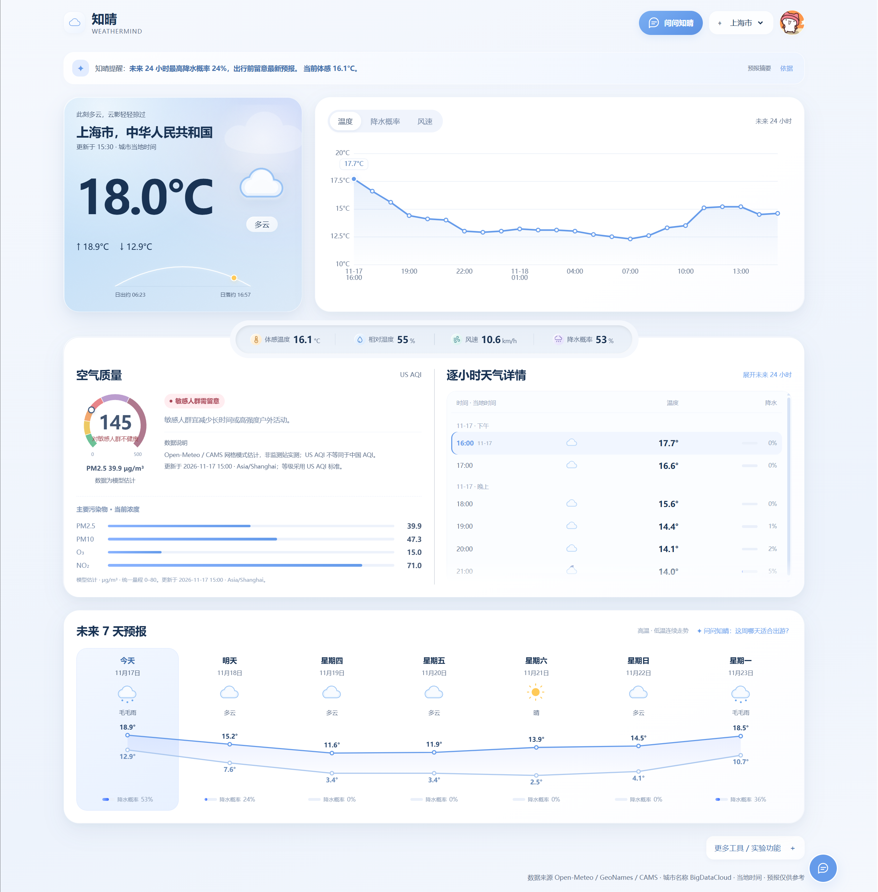

# 知晴 WeatherMind

面向校园通勤与户外活动的天气决策 Agent。首页 UI 采用 **Dashboard（仪表盘）形式**，集中展示天气概览、逐小时趋势、空气质量和七日预报；完整助手和悬浮小窗支持自然语言查询。

游客可查看天气；登录后使用规则助手，或自行配置可选的 Qwen。课程机器学习部分为上海市域下一小时气温 Ridge 回归，具备独立数据、基线、时间划分和逐条预测记录。



## 课程材料

报告封面的课程教师仍待作者填写。

- [报告 PDF](report/028123215_阮佳惠_知晴天气决策Agent.pdf) · [可编辑 Word](report/028123215_阮佳惠_知晴天气决策Agent.docx)
- [完整助手界面](docs/screenshots/assistant.png) · [悬浮助手界面](docs/screenshots/compact-assistant.png) · [演示步骤](docs/DEMO.md)
- [上海市域实验说明](SHANGHAI_REGIONAL_REPORT.md) · [原始指标](artifacts/hourly_regional/metrics.json) · [逐条预测 gzip](artifacts/hourly_regional/test_predictions.csv.gz)
- [模型误差图](docs/experiments/01_测试集模型误差对比.png) · [失败案例曲线](docs/experiments/02_最大误差案例预测曲线.png)
- [组件来源与许可](docs/THIRD_PARTY_NOTICES.md) · [技能复用记录](docs/SKILL_REUSE.md) · [复核记录](docs/VALIDATION.md)

截图由作者提供，展示2026年11月17日当前版本。完整助手截图为欢迎页，小窗截图为初始摘要，不能代替完整问答的执行证据；旧版截图不作为当前界面。

## 安装与启动

推荐 Python 3.14（本次复核环境）；其他 Python 版本须确认依赖可用。本地原型使用 Flask、SQLite、原生 JavaScript 和本地 ECharts，无需 Node 构建。天气接口需要网络。

```powershell
git clone https://github.com/Eryuan127/zhiqing-weathermind.git
cd zhiqing-weathermind
python -m venv .venv
.venv\Scripts\python -m pip install -r requirements-lock.txt
.venv\Scripts\python run_weather.py
```

入口是 **run_weather.py**，默认访问 http://127.0.0.1:5001/ 。端口被占用时使用 `python run_weather.py --port 5002`。在页面注册自己的测试账号；仓库不提供已有用户数据库。

macOS/Linux 使用 `.venv/bin/python` 替换上面的解释器路径。

## 使用流程

1. 授权定位或手动选城市；定位失败会提示选城，不静默回退上海。
2. 点击“问问知晴”进入完整助手，或使用右下角小窗。完整对话由登录后的 `/assistant?embedded=1` 内嵌页面提供。
3. 例如提问“明天下午上海会下雨吗”，核对城市、时间窗口及数据依据。
4. 通过“更多工具 / 实验功能”运行上海下一整点气温模型。域外地点应得到明确范围提示。

位置按本轮明确城市、有效会话位置和账号绑定位置处理。切换账号清理共享上下文；接口校验会话归属。小窗最多5次提问后可转完整对话。

## 机器学习实验与复核

主实验使用上海12个公开研究采样点、10个ERA5网格，2023训练、2024验证、2025测试。特征为前1、2、24小时气温及小时周期编码；只用验证集选模。

| 模型 | 测试MAE °C | 测试RMSE °C |
|---|---:|---:|
| 持久性基线 | 0.468988 | 0.797486 |
| 线性回归 | 0.443984 | 0.685559 |
| Ridge | 0.443937 | 0.685480 |

Ridge相对持久性基线MAE降低约5.34%；和线性回归的差距极小，不能宣称显著优于线性回归。空间整网格留出10组中7组优于基线，3组未优于。以上是历史再分析回放，**不代表实时预测准确率，也不是优于业务天气预报的证明**。

逐条预测以gzip保存以减小仓库体积，解压即为原始CSV。下列检查直接读取压缩文件、重算105120条预测的MAE与RMSE，并核对已保存指标：

```powershell
python scripts/verify_experiments.py
```

重新训练（优先使用仓库缓存，缺少数据时才访问历史API）：

```powershell
python scripts/train_shanghai_regional.py
```

边界已随模型提供，无需在首次启动前重新准备。只有修改原始边界时才运行 `python scripts/prepare_shanghai_boundary.py`，随后重训模型使边界哈希对应。

重新绘图：

```powershell
python -m pip install -r requirements-plot.txt
python scripts/plot_report_experiments.py
```

输出到 `artifacts/report_figures/`。最大误差曲线按最大绝对误差选择，是失败诊断图，不代表随机样本平均表现。

`artifacts/hourly/` 是旧单点小时实验，`artifacts/ml/` 是日均温历史回放，均与部署中的 `hourly_regional` 主实验分开保存。日均温回放只支持2025年，使用前须确认数据哈希与模型版本对应。

## 测试与历史记录

```powershell
python -m pip install -r requirements-dev.txt
python -m pytest tests -q -ra
```

单元测试使用明确夹具，不代表真实API成功率。`data/task_benchmark.json` 为开发者编写的回归任务集，不是独立用户研究。已上传[历史规则模式合同检查摘要](artifacts/evaluation/20261107-rules-public.json)，6例通过6例；检查范围是城市、工具及状态，不能称为用户任务完成率100%。标识符和坐标已从公开摘要排除，原始会话数据库不公开。

需要重新访问真实服务时显式运行：

```powershell
python scripts/evaluate_tasks.py --live --mode rules --limit 6
```

新生成的原始评估默认被Git忽略，核验、脱敏后再选择公开。历史单点分组诊断在 `artifacts/hourly/analysis/`，复核说明见 `docs/VALIDATION.md`。

## Qwen 可选配置

规则模式无需模型密钥。在本地复制 `.env.example` 为 `.env`，配置 `DASHSCOPE_API_KEY`、`QWEN_MODEL`、`QWEN_BASE_URL`。只有自行确认账户额度和用完即停后才设置 `QWEN_FREE_ONLY_CONFIRMED=true`；程序不能查询余额或承诺免费。Qwen失败时明确报错，不自动换模型。正常结束记录服务商返回的用量；取消时缺失用量记为未知，不当作0。

停止生成、复制和个人修订只影响相应消息流程；个人修订会标记，不能冒充模型原答。服务商已处理的请求可能仍计费。

## 数据与发布边界

- Open-Meteo当前天气、小时与日预报分别解释；降水概率不是实时降水量。
- 空气质量采用Open-Meteo/CAMS模式估计、US AQI和PM2.5，不是附近站点实测，也不等于中国AQI。
- ERA5为历史再分析；重复和邻近网格存在相关性，不能按样本条数声称完全独立观测。
- DataV/AMAP边界用于学习交流，不是权威测绘界线。GCJ-02经近似转换为WGS84；商业及其他再分发用途需另核验授权。
- `.env`、`.session-secret`、SQLite数据库、账号资料及用户精确位置不得上传。当前仓库不包含这些运行数据。
- 当前提供本地可运行原型；GitHub仓库页面本身不是已部署的Flask服务。重要出行请复核官方预报和预警。

本项目自身尚未指定开源许可证，第三方组件按各自许可使用。完整来源见 `docs/THIRD_PARTY_NOTICES.md`。生成式AI参与了开发与报告整理，作者须能解释和核验提交内容。
